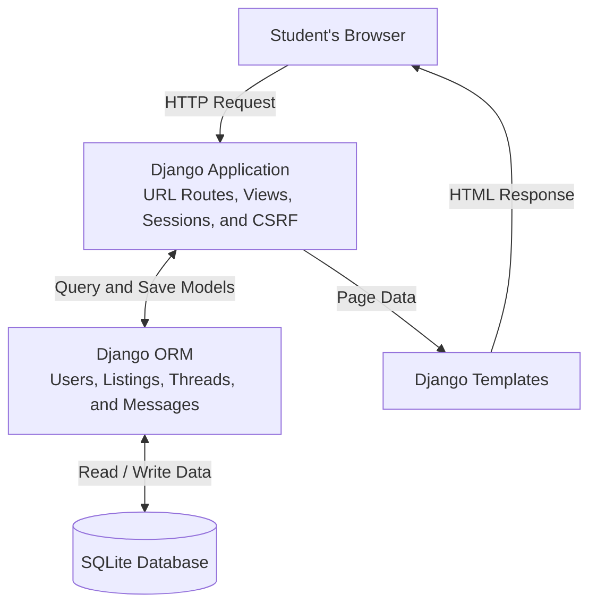

# SwapShelf: Architecture sketch

This sketch describes the patched application.

- **Creating a post:** The browser submits a form to `POST /listings/new/`. The view requires sign-in, validates a `ListingForm`, assigns `request.user` as the owner, and saves the listing through Django's ORM. It redirects the browser to the new listing's detail page.

- **Authentication and ownership:** Django's authentication and session middleware identify the current user. Protected views use `login_required`. After the patch, editing, marking sold, and removing a listing also require a database lookup matching both its ID and `owner=request.user`. Nonowners receive 404. Sold and delete actions require POST.

- **Board and listing pages:** The public board reads the optional `category` query parameter and filters listings through the ORM, excluding those marked removed. A detail page retrieves a listing by ID and displays its public information. Private seller notes appear only in the owner-authorized edit form. Removal hides a listing from the board; it does not make its public detail URL inaccessible.

- **Private messages:** A CSRF-protected `POST /listings/<id>/message/` creates or reuses a thread with the current user as its buyer. A thread links that buyer to a listing and its seller. `GET /threads/<id>/` reads messages, and POST to the same route sends a reply. Both operations first check that the current user is the buyer or listing owner; the server assigns the message sender.

- **Profiles and department desk:** `POST /profile/` saves only first name, last name, and email. It cannot change `is_staff`. The `/desk/` view uses the administrator-controlled staff flag to decide whether to return restricted department information. Django admin is a separate interface at `/admin/`, with its own permission checks.

- **Page rendering:** Views pass model data and forms to Django templates. Templates generate HTML with default escaping, and forms for authenticated changes include CSRF tokens. Browser controls help users navigate, while views enforce access restrictions on the server.

- **Storage and startup:** SQLite stores users, sessions, listings, threads, and messages. Its default location is `data/swapshelf.db`; Docker uses `/app/data/swapshelf.db`, persisted by a named volume in Compose. Local development uses Django's server; Docker runs Gunicorn after migrations. Demo data is created only when the operator explicitly runs the seed command.
